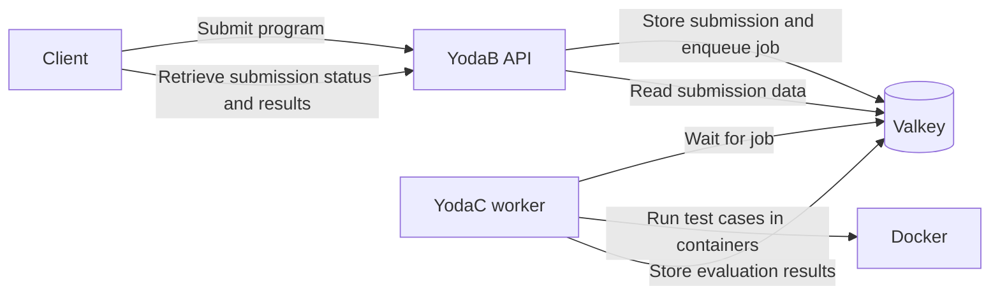

# Yoda

[](https://ocaml.org/)
[](https://github.com/pedrocasais/yoda/actions/workflows/build-yoda.yml)

Yoda is an automated judge for programming exercises and contests. Users submit source code, Yoda compiles and runs it against test cases in isolated containers, and reports the results, helping instructors and organizers give fast, consistent feedback.

Yoda supports user authentication with role-based access for regular users, judges, and administrators. Judges and administrators can create contests, while administrators manage problems and their test cases, and participants submit solutions and follow submissions and contest scoreboards. Submissions are evaluated asynchronously, with a result for each test case. Test cases can compare a program's output with an expected output or use a custom checker, called an oracle (see [Test cases and oracles](docs/testcases.md)). Administrators can also re-evaluate a submission, review usage statistics, and manage the supported programming languages. Each language runs in its own container image, and new languages can be added without changing the code (see [Supporting new languages](docs/languages.md)). The whole platform is exposed through a REST API described in an [OpenAPI specification](schemas/openapi.yaml).

The platform is made up of four components. The [Yoda web frontend](https://github.com/anmaped/yoda-web) (service `yoda-a`) provides the browser interface. YodaB, an OCaml and Dream REST API, manages users, contests, problems, and submissions. YodaC, an OCaml worker, takes queued submissions, compiles and runs them in Docker containers, and records the results. Valkey, a Redis-compatible key-value store, holds the application data and the submission queue.


## Quick start

### Prerequisites

- Docker Engine with the Docker Compose plugin, or Podman with a Compose provider
- Git

Clone the repository, then choose Docker Compose or Podman Compose:

```bash
git clone https://github.com/pedrocasais/yoda.git
cd yoda

# Docker:
docker compose pull
docker compose up -d --no-build
```

For rootless Podman on a Linux host using systemd, enable Podman's Docker-compatible API socket and point the stack at it:

```bash
systemctl --user enable --now podman.socket
export CONTAINER_ENGINE_SOCKET="$XDG_RUNTIME_DIR/podman/podman.sock"

podman compose pull
podman compose up -d --no-build
```

This pulls `ghcr.io/pedrocasais/yoda:master` for YodaB and YodaC, then starts the services defined in `docker-compose.yaml`. The web UI, provided by the [Yoda web frontend](https://github.com/anmaped/yoda-web), is at [http://localhost](http://localhost); the API status endpoint is [http://localhost/api/status](http://localhost/api/status). The API specification is in [`schemas/openapi.yaml`](schemas/openapi.yaml).

Install a Compose provider supported by `podman compose` if you do not already have one. The `CONTAINER_ENGINE_SOCKET` setting mounts Podman's API socket inside YodaC at `/var/run/docker.sock`, where the worker expects to find the container engine API. If you use rootful Podman instead, start its socket with `sudo systemctl enable --now podman.socket` and set `CONTAINER_ENGINE_SOCKET=/run/podman/podman.sock`.

Useful commands:

```bash
# Docker:
docker compose ps
docker compose logs -f yoda-b yoda-c
docker compose down

# Or Podman:
podman compose ps
podman compose logs -f yoda-b yoda-c
podman compose down
```

The `compose down` command stops and removes the containers but keeps the Valkey data volume.

### Security note

Yoda runs untrusted code, so deploy it carefully.

- **Engine socket.** YodaC runs as root and mounts the host container-engine socket to start execution containers. Access to that socket is equivalent to control of the host. Prefer rootless Podman, which limits the impact to a normal user account.
- **Isolation is not a full sandbox.** Submissions run in separate containers with no network access and a memory limit, but they share the host kernel. Compilation runs with a read-write working directory and no memory limit. Run Yoda on a dedicated host or virtual machine, not on a machine that holds sensitive data.
- **Exposed ports.** Only the web frontend's port `80` is published to the network. Valkey (`6379`) is bound to `127.0.0.1` because it is not authenticated, and YodaB is reachable only through the frontend's `/api` proxy. Valkey holds all users, password hashes, and submissions, so never publish it to untrusted networks.
- **Administrators.** Administrators can change the language images and commands YodaC runs, and upload the oracle executables. Grant the role only to people you trust, and use images from registries you trust.
- **Images.** The Compose file uses `latest` and `master` tags. Pin versions or digests for production deployments.

For public or multi-tenant deployments, add TLS in front of the web frontend and further isolation, such as a dedicated engine or virtual machine for evaluation.

## How it works

YodaB accepts a submission, stores it, and places a job on Valkey's `submission:job` queue. YodaC waits for queued jobs, runs their test cases in Docker containers, and stores the evaluation results. Clients can then retrieve submission status and results through the API.



## Services

The Docker Compose stack includes:

| Service | Purpose |
|---------|---------|
| `yoda-a` | [Yoda web frontend](https://github.com/anmaped/yoda-web), served at `http://localhost`. Its nginx server also proxies `/api` to YodaB. |
| `yoda-b` | REST API, reachable only inside the Compose network and through the frontend's `/api` proxy |
| `yoda-c` | Background judge worker |
| `valkey` | Application data and submission queue |

The frontend is configured with `BASE_API_URL` (where the browser sends API requests) and `API_ROUTING_URL` (where nginx forwards `/api`). The Compose file sets them to `http://localhost/api` and `http://yoda-b:8001/`. To serve Yoda from another host name, change `BASE_API_URL` to match it.

YodaB and YodaC are built from the same container image; YodaB is the default command, while the Compose configuration starts YodaC with `./yodac.exe`.

## Container image

The GitHub Actions workflow publishes `ghcr.io/pedrocasais/yoda` on pushes to the `master` branch and on published releases. Branch builds are tagged `master`; release builds receive version tags.

Pull the latest `master` image:

```bash
docker pull ghcr.io/pedrocasais/yoda:master
```

The image includes both executables. By default it starts YodaB; run `./yodac.exe` to start the worker.

## Development

Use the repository's [VS Code Dev Container](.devcontainer/devcontainer.json) for development. Open the repository in VS Code and choose **Reopen in Container**. The Dev Container installs the OCaml development dependencies and tools.

```bash
make build
```

To run the application stack locally, use Docker Compose or Podman Compose from the host, as described in [Quick start](#quick-start). The Dev Container is for editing and building the code; the Compose stack builds and runs the Yoda services.

The Makefile also provides targets for generating code from the OpenAPI specification. See [`tools/readme.md`](tools/readme.md) for the available commands.
