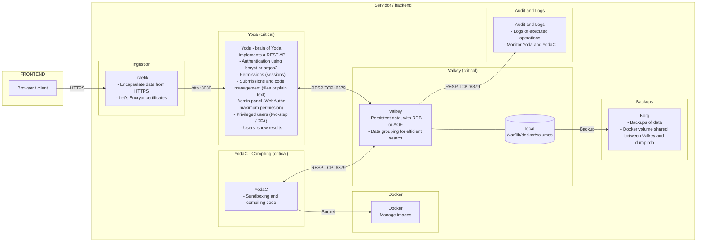

# Infrastructure architecture

This diagram shows the reference deployment of Yoda: how traffic enters the platform, which services run on the server, and where data, logs, and backups live.

## Components

| Component | Role |
|-----------|------|
| **Traefik** | Entry point. Receives requests from the client, encapsulates the data in HTTPS using Let's Encrypt certificates, and forwards them to Yoda. |
| **Yoda** | The REST API. Handles authentication (bcrypt or Argon2), permissions through sessions, submissions and code management, the admin panel, and results. |
| **YodaC** | Compiles and runs submissions in a sandbox. It uses Valkey for its queue and data, and the Docker socket to start and manage containers and images. |
| **Valkey** | Persistent data store, using RDB or AOF, with data grouped for efficient search. Its data lives in a local Docker volume. |
| **Docker** | Container engine used by YodaC, reached through its socket. |
| **Borg** | Backs up the Valkey data volume, shared between Valkey and `dump.rdb`. |
| **Audit and Logs** | Records the operations that were executed and lets you monitor Yoda and YodaC. |

Yoda, Valkey, and YodaC are marked as critical in the original diagram.

## Notes

- This is the reference architecture. The repository's `docker-compose.yaml` starts a smaller development stack, with the web frontend proxying `/api` to YodaB instead of Traefik, and without Borg backups or the audit and log service.
- YodaB listens on port `8001` in the current code, while the original diagram labels the Traefik-to-Yoda link as port `8080`. Confirm the port when you configure the proxy.
